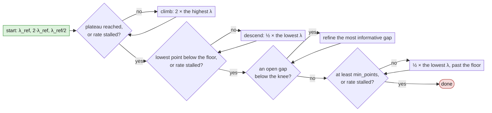

# Reproducing the published results

This guide has four parts:

1. **Raw and additional results:** the raw result files behind every figure and table, and more figures drawn
   from them than a 10-page paper has room for.
2. **The published weights:** how to download the codec checkpoints.
3. **Recreating each result file:** how each file in `results/` was made, and the command that recreates it from
   the published weights: the sweeps, the cross-model tests, the standard-codec anchors, and the paper's figures and
   tables drawn from those files. Each method is explained with one example command. Full commands, including
   all necessary arguments, are in [`REPRODUCE_COMMANDS.md`](REPRODUCE_COMMANDS.md).
4. **Training parameters:** the parameters used to train every codec.

The task models, by their short names, are listed at the end, in [Task models](#task-models).

Install the package first (see the README). The commands use these shell variables:

- `$DATA_COCO`: the COCO root, and `$DATA_ADE`: the `ADEChallengeData2016` directory (README, *Data*). Testing
  uses COCO `val2017` and the ADE20K validation images only.
- `$WEIGHTS`: the directory holding the published codec weights (part 2).
- `$CKPT`: where training runs save their checkpoints.

## 1. Raw and additional results

The paper shows the mean RD curves per backbone, the cross-model scatter and the BD-rate tables. Everything behind
them is in `results/`:

- [`results/selected/`](results/selected/) holds 25 sweeps, one per task model, of the codec selected to represent
  the model:
  - 16 codecs trained with the unified recipe;
  - 6 rescued codecs: the unified run collapsed, and a retrain with a raised `lambda_ref` replaced it;
  - 3 fine-tuned codecs: the unified run worked but was suboptimal, and a retrain with a raised `lambda_ref`
    replaced it (`SegMask2FormerResNet`, `SegMaskFormerResNet`, `GLIP`).

  Each file is named by its weights file (`SegUperNetResNet.ckpt` → `SegUperNetResNet.json`) and holds:
  - `task_model`, `lambda_ref` and `metric`;
  - the uncompressed score `baseline`;
  - `rd_points`, each `{lambda, bpp, value, metric}`;
  - the run's `run_hash` and its training settings `train_params`.
- [`results/replaced/`](results/replaced/) holds 7 sweeps in the same format, of the unified-recipe runs that a
  retrain replaced (they are drawn in the per-model figures and counted in the BD-rate tables, but not in the mean
  curves):
  - the 4 that collapsed: `DINOResNet`, `DDQDETRResNet`, `DeformableDETR`, `SegUperNetResNet`;
  - the 3 that worked but were suboptimal: `SegMask2FormerResNet`, `SegMaskFormerResNet`, `GLIP`.
- [`results/cross_model/`](results/cross_model/) holds every cross-model test (calibration is explained in
  [The cross-model tests](#the-cross-model-tests)):
  - `nocal/` has 27 files: the 25 codecs of `selected/` and the two replaced `lambda_ref` 5 segmentation codecs.
  - `cal/` has 15: one for each of those codecs whose task model has a ResNet-50 backbone.
  - `cal_test/` has the same 15 with test-set statistics, as in the submitted paper.
  - Each file names the codec (`trained_on_task_model`) and holds one entry per target task model, with the
    target's uncompressed score `baseline` and its `rd_points`.
- [`results/anchors/anchor_eval.jsonl`](results/anchors/anchor_eval.jsonl): the standard codecs' results, one line
  per task model, codec and quality setting.
  - The rate is given two ways: `bpp_aggregate` (total bits over total pixels of the test set) and
    `bpp_mean_image` (the mean of each image's bits over its pixels).
  - `metric` is the task score.

From these files, `scripts/run_paper_results.sh` draws the following into [`results/paper/`](results/paper/), where
they are committed so they can be viewed without running it (see [Running the script](#running-the-script)):


| file(s) | what it shows |
|---|---|
| `per_model/<model>_rd.png` (25) | RD curves of one task model: our codec's sweeps (the replaced sweep too, where there is one) against the four standard codecs |
| `summaries/seg_mean.png`, `summaries/det_mean.png` | Mean RD curves per backbone, with the mean over all backbones, as a fraction of the uncompressed score |
| `summaries/{seg,det}_models_{absolute,delta,ratio}.png` | Multiple models RD curves together using absolute metric, as well as difference to or ratio of uncompressed|
| `summaries/{resnet,swin_t,swin_l}/` | Same figures per backbone group, alongside raw results in JSON and CSV format |
| `summaries/bd_rates.csv`, `summaries/bd_rates_per_sweep.csv` | BD-rate tables against VTM (QPA) and BPG, per recipe group and per sweep, every value at full precision |
| `summaries/cross_model/<task>_<group>_<setting>_bd_matrix.png` (7) | Cross-model BD-rate matrices, one per task, backbone group and calibration setting |
| `summaries/cross_model/cross_model_scatter.png`, `cross_model_scatter_uncal.png` | Each cross-model pair's BD-rate against VTM (QPA) and against the target's own codec, with each group's mean; calibrated and uncalibrated |

## 2. The published weights

The 32 codec checkpoints are archived on Zenodo, <https://doi.org/10.5281/zenodo.23408855>, with a mirror hosted by
the Digital Research Alliance of Canada. They are the codecs of the 25 selected and the 7 replaced sweeps, about
85 MB each and 2.7 GB in all, named as in [`REPRODUCE_COMMANDS.md`](REPRODUCE_COMMANDS.md). Each file holds the codec weights only (no optimiser
state), plus the epoch and step it was saved at.

**With the script** (standard library only):

```bash
python scripts/download_weights.py --to $WEIGHTS                       # all 32
python scripts/download_weights.py --to $WEIGHTS --only FasterRCNN.ckpt GLIP.ckpt
```

It reads `weights/manifest.json` (each file's name, size, sha256 and the run it comes from), downloads from the
mirror or, failing that, from Zenodo, and checks each file's size and sha256. A file already present and correct
is skipped.

**By hand:** download the files from the Zenodo record (each file, or the whole record as one archive) or from the
mirror, `https://object-arbutus.alliancecan.ca/6c162a6eb85b4659a5210b4712832d98:cfm-public/cfwm/v1.0/<file name>`
together with `SHA256SUMS`. Then check them:

```bash
cd $WEIGHTS && sha256sum -c SHA256SUMS
```

The same record holds the COCO split annotation files (part 4): `python scripts/download_weights.py --coco-splits
$DATA_COCO` unpacks them into `$DATA_COCO/annotations/`.

## 3. Recreating each result file

### What "reproduce" means

The test scripts ask PyTorch for deterministic algorithms, but results are still not bit-identical:
- some operations have no deterministic implementation;
- kernels differ between GPU types.

mIoU is reported in percent (e.g. 43.40) and mAP as a fraction (e.g. 0.583). Likely approximate deviations to
expect:

| setting | mIoU | mAP | bpp |
|---|---|---|---|
| the same GPU type as the published sweep | equal to 2 decimals | equal to 3 decimals | within 0.1% |
| a different GPU type | within 0.5 points | within 0.005 | within 0.5% |

The mAP tolerance on a different GPU type is scaled from the measured mIoU spread, not measured itself.

A rate-guided sweep chooses each next lambda from the points it has measured, so a small difference in one point
can lead two sweeps to different lambdas after it. Compare a reproduced sweep with the published one as two RD
curves at matched bpp, not point by point.

This repository's code is a cleaned-up copy of the research code that produced the published results. To check
that the clean-up changed no result, a representative subset of the published tests and training runs was repeated
with both codes on the same GPU; every result agreed within the tolerances above.

**How bpp is measured.** A codec's bpp at one lambda is the mean, over the test images, of each image's bitstream
size (all strings plus their headers) in bits divided by the image's original pixel count. The standard codecs'
rates are averaged the same way, per image (see [A correction to the submitted paper's
BD-rates](#a-correction-to-the-submitted-papers-bd-rates)).

### How the rate-guided sweep chooses its points

The sweep picks each next lambda from the points measured so far, in four phases: it climbs until the score stops
improving, descends until the score falls below a floor, splits the gaps in between, and, if it still has fewer
than `--min_points` points, adds more below the floor. Each decision depends only on the points in the results
file, so an interrupted sweep, relaunched, continues where it stopped. The exact rules are in
`cfwm_repro/tools/rate_guided_sweep.py`.



The terms, with the flag and default of each (every published sweep used the defaults):

- **Plateau:** every point in the top 2× of measured bpp scores within `--plateau_tol` (0.015) of the best score.
- **Rate stalled:** one ×2 step in lambda (up when climbing, down when descending) changed the bpp by less than
  `--rate_stall` (10%).
- **Floor:** a score below `--floor_frac` (0.6) of the uncompressed score.
- **Knee:** the lowest-lambda point of the plateau.
- **Open gap:** two neighbouring points more than √2× apart in bpp or more than `--q_step` (0.03) apart in score.
- **Most informative gap:** first the two ×2 steps just below the knee, then any open gap whose upper point scores at
  least `--hi_frac` (0.85) of the uncompressed score, widest first. A gap is split at the geometric mean of its two
  lambdas.
- **Points:** `--min_points` 8; `--max_points` 14 stops the sweep at any step.

**The command**, here for `FasterRCNN` (every sweep's is in [`REPRODUCE_COMMANDS.md`](REPRODUCE_COMMANDS.md#the-selected-sweeps),
with the [replaced ones](REPRODUCE_COMMANDS.md#the-replaced-sweeps) after them):

<!-- check: parse -->
```bash
python -m cfwm_repro.tools.test_rate_guided --task_model FasterRCNN --data_root ${DATA_COCO} --checkpoint ${WEIGHTS}/FasterRCNN.ckpt --results_dir results/mine
```

It writes `results/mine/FasterRCNN__FasterRCNN.json`; compare it with `results/selected/FasterRCNN.json`. The sweep
flags are left at their defaults, the published settings.

### The cross-model tests

**The script.** `cfwm_repro.tools.test_cross_model` tests one codec on other task models. For each target, the
target model runs up to the cut point and produces its features. The codec compresses them, and the decoded
features are passed on to the remainder of the target task model. Each target gets its own rate-guided sweep, with
the flags and defaults above. A target whose cut-point shape differs from the codec's is recorded as
`skipped_incompatible`.

**Calibration.** Two task models with the same backbone produce cut-point features of the same shape, but not with
the same statistics: each model was trained with its own head, so each channel's offset and scale differ. A codec
trained on one model's features therefore sees another model's features shifted and rescaled. Calibration corrects
this per channel: the target's features are mapped to the codec's own scale before coding, and the decoded features
are mapped back,

```math
x' = \frac{x - \mu_t}{\sigma_t}\,\sigma_s + \mu_s, \qquad \hat{x} = \frac{\hat{x}' - \mu_s}{\sigma_s}\,\sigma_t + \mu_t
```

where $`\mu`$ and $`\sigma`$ are the per-channel means and standard deviations of the cut-point features of the
codec's own task model ($`s`$) and of the target ($`t`$). Calibration applies to ConvNet backbones only.

`--calibration_stats` chooses where those statistics come from:
- `train` (the default): the first 2000 training images, in the order of the annotation file;
- `test`: the test images;
- `none`: no calibration; the target's features go to the codec unchanged.

**The published files.** Each file in `results/cross_model/` was assembled from several jobs that split one codec's
targets between them; the single command per file gives the same file in one job. Its targets are the other models
of the codec's backbone group in the *Task models* table; the segmentation ResNet codecs also target
`SegFCNResNet`. The `cal` files use `--calibration_stats train`, the `cal_test` files `--calibration_stats test` and
the `nocal` files `--calibration_stats none`. Our experiments show that using test or training statistics has
little to no impact on the cross-model results or their conclusions. Compare each target's entry with the published
one at matched bpp, as for the sweeps.

**The command**, here for the `FasterRCNN` codec, calibrated (every file's is in
[`REPRODUCE_COMMANDS.md`](REPRODUCE_COMMANDS.md#the-cross-model-commands)):

<!-- check: parse -->
```bash
python -m cfwm_repro.tools.test_cross_model --task_model FasterRCNN --checkpoint ${WEIGHTS}/FasterRCNN.ckpt --target_task_models ATSSResNet,CascadeMaskRCNN,DDQDETRResNet,DINOResNet,DeformableDETR,FCOS,Mask2FormerResNet,RetinaNet --data_root ${DATA_COCO} --results_dir results/mine/cross_model/cal --calibration_stats train
```

Each setting writes into its own folder: a codec's results file has the same name in every setting.

### The standard-codec anchors

Anchor images are not provided, but can be recreated using publicly available tools with the settings below.

**Images.** All 5000 COCO `val2017` images and all 2000 ADE20K validation images are encoded at their native
resolution, one image per bitstream. Each decoded image is checked to be the original size.

**Codecs** (the four used in the figures and tables):

| anchor | encoder | settings | quality values |
|---|---|---|---|
| `vtm_qpa1` | VTM 23.9 `EncoderApp`, all-intra configuration `encoder_intra_vtm.cfg` | YUV 4:2:0, 10-bit, `--PerceptQPA=1` | QP 14, 17, 20, 23, 26, 29, 32, 35, 38, 41, 44, 47, 50, 53 |
| `vvenc_qpa1` | VVenC 1.15 through FFmpeg 9.0 (`libvvenc`) | YUV 4:2:0, 10-bit, `-preset slower -qpa 1`, one intra frame | QP 17, 20, 23, 26, 29, 32, 35, 38, 41, 44, 47, 50, 53, 56 |
| `bpg` | libbpg 0.9.8 `bpgenc` (x265 backend, default `-m 8`) | its defaults: YCbCr 4:2:0, 8-bit, full range | `-q` 19, 22, 24, 27, 29, 32, 34, 37, 39, 42, 44, 47, 49, 51 |
| `jpeg` | FFmpeg 9.0's `mjpeg` encoder | `-pix_fmt yuvj420p` (4:2:0, 8-bit, full range) | `-q:v` 2, 3, 4, 5, 6, 8, 11, 17, 24, 31 |

- **Colour conversion for VTM and VVenC:** RGB to YUV with FFmpeg, full range, BT.601, flags
  `lanczos+accurate_rnd+full_chroma_int+full_chroma_inp`.
- **Odd sizes:** an odd-sized image is padded to even before encoding and cropped back after decoding.
- **Rate:** an image's bpp is its bitstream file size in bits over its original pixel count.
- **Task scores:** each task model, unsplit and unchanged, runs on the decoded images with its own test pipeline
  and evaluator, against the original annotations.

**Also in the file, but not used in any figure or table:** VTM and VVenC with perceptual QP adaptation off.

| anchor | encoder | settings | quality values |
|---|---|---|---|
| `vtm` | as `vtm_qpa1` | perceptual QP adaptation off | QP 14, 17, 20, 23, 26, 29, 32, 35, 41, 47 |
| `vvenc` | as `vvenc_qpa1` | `-qpa 0` | QP 17, 20, 23, 26, 29, 32, 35, 38, 44, 50 |

The figures and tables use `vtm_qpa1` (the main reference, in every BD-rate), `bpg` (the second BD-rate reference),
and `jpeg` and `vvenc_qpa1` (drawn in the per-model figures; `jpeg` also in the mean curves).

### The paper's figures and tables

#### A correction to the submitted paper's BD-rates

The submitted paper compared rates computed in two different ways:

- **Our codec:** each test image's bits (its whole bitstream) divided by that image's pixel count, averaged over the
  test images. This is the *per-image mean* bpp.
- **The standard codecs** (VTM, VVenC, BPG, JPEG): the total bits of all test images divided by their total pixel
  count. This is the *aggregate* bpp.

The two differ whenever an image's bpp depends on its size. For the standard codecs, the per-image mean is 1.10 to
1.23 times the aggregate on ADE20K, whose images vary widely in size, and 1.00 to 1.02 times on COCO. Comparing
our codecs' per-image means with the anchors' aggregate therefore placed the standard codecs at too low a rate, and
under-reported our BD-rate savings, mostly for segmentation. The task scores are not affected: both rates describe
the same decoded images. Our codec's own per-image mean is 1.49 to 1.53 times its aggregate on ADE20K and 1.06
times on COCO, so comparing aggregate with aggregate would favour our codec more still. Both rates of every
standard-codec point are in `results/anchors/anchor_eval.jsonl` (`bpp_mean_image` and `bpp_aggregate`).

This repository compares per-image mean with per-image mean. The BD-rate table (`summaries/bd_rates.csv`) changes
from the submitted paper's values to:

| task | row | vs VTM (QPA) | vs VTM (QPA), ≥ 90% | vs BPG | vs BPG, ≥ 90% |
|---|---|---|---|---|---|
| mIoU | Unified recipe | -60.1 → **-64.2** | -63.8 → **-67.5** | -64.1 → **-67.8** | -67.7 → **-70.6** |
| mIoU | Fine-tuned | -66.2 → **-71.1** | -73.1 → **-77.3** | -71.5 → **-75.9** | -77.6 → **-80.8** |
| mAP | Unified recipe | -45.5 → **-45.8** | -43.8 → **-44.0** | -52.1 → **-52.2** | -48.3 → **-48.4** |
| mAP | Fine-tuned | -62.9 → **-63.4** | -66.4 → **-66.7** | -72.4 → **-72.5** | -73.6 → **-73.6** |
| mAP | Mask2Former-R50 | -44.1 → **-45.0** | — | -59.4 → **-59.7** | — |

BD-rates in percent; "≥ 90%" integrates only over task scores of at least 90% of the uncompressed score, which
Mask2Former-R50 never reaches. The mean curves' savings against VTM (QPA), at 90% / 95% of the uncompressed score,
change as follows:

| task | backbone | at 90% | at 95% |
|---|---|---|---|
| mIoU | ResNet | 77% → **80%** | 80% → **83%** |
| mIoU | Swin-T | 72% → **76%** | 45% → **53%** |
| mAP | ResNet | 77% → **78%** | 76% → **76%** |
| mAP | Swin-T | 69% → **69%** | 66% → **66%** |
| mAP | Swin-L | 48% → **48%** | 49% → **50%** |

The figures drawn against the standard codecs (the per-model and mean RD curves, the cross-model BD-rate matrices and
scatter plots) move in the same direction. To regenerate the submitted paper's version of every figure and table:

```bash
scripts/run_paper_results.sh results/paper_submitted --anchor-bpp aggregate
```

#### Running the script

```bash
scripts/run_paper_results.sh            # writes results/paper/
```

runs `python -m cfwm_repro.results` on the result files above, and prints the runs it uses. Each run is named by
its `run_hash`. `cfwm_repro/results/config.py` assigns every run to a group:
- `UNIFIED`: the unified recipe;
- `RESCUED`: a retrain after the unified run collapsed;
- `FINETUNED`: a retrain that replaced a working but suboptimal unified run.

A run in none of the three is left out, with a warning. It writes the files listed in part 1.

## 4. Training parameters

Training is reproducible only approximately. The GPU type, the batch size and restarts after preemption all change
the weights a run ends with. A retrained codec should give an RD curve close to the published one, not the same
weights.

### Data

Detection codecs train on COCO `train2017` [3], split into 112,372 training and 5,915 validation images; `val2017`
is the test set. The split annotation files are downloaded with

```bash
python scripts/download_weights.py --coco-splits $DATA_COCO
```

or rebuilt, identically, from the image ids in `splits/` and COCO's `annotations/instances_train2017.json`:

```bash
python scripts/make_coco_split.py --coco $DATA_COCO
```

Both give `annotations/coco2017_trn_split_anns.json` and `annotations/coco2017_val_split_anns.json`. Images without
annotations are dropped by the task models' own data filters. Segmentation codecs train on the 20,210 ADE20K [4]
training images.

**Validation.** Every epoch ends with a validation pass, on the COCO validation split or on the ADE20K validation
images (which are also the ADE20K test images). Every 5 epochs of stage 2 it also measures the task score at
$`\lambda_{ref}`$ and its bpp. Both are only logged. Nothing is chosen from it:
- the published checkpoint is the last epoch's;
- there is no early stopping.

### The unified recipe

**Cut point.** Every task model was split with CFM-Model-Zoo at `cut_point=1`, after the first stage of its
backbone. The codec compresses the features there, and the rest of the task model (the remaining backbone stages, the
neck and the head) runs on the decoded features. Per backbone:
- **ResNet-50:** after the stem and the first residual stage (`layer1`): a 256-channel feature map at 1/4 of the input
  resolution.
- **Swin-T:** after the patch embedding and the first Swin stage, before its patch merging: 96-channel tokens on a
  1/4-resolution grid, which the codec reshapes into a feature map.
- **Swin-L:** the same, with 192 channels.

The cut point is fixed in the code; it is not a command-line option.

**Loss.** For a batch of $`B`$ images, with $`\lambda_i`$ the lambda of image $`i`$:

```math
\mathcal{L} = \frac{1}{B} \sum_{i=1}^{B} \lambda_i D_i + R,
\qquad
D_i = \frac{1}{S} \sum_{s=1}^{S} \mathrm{MSE}\big(F_s(\hat{x}_i),\ F_s(x_i)\big)
```

```math
R = \frac{\sum_{i=1}^{B} R_i}{\sum_{i=1}^{B} P_i}
```

- $`x_i`$ are the task model's features at the cut point (after the first backbone stage), and $`\hat{x}_i`$ the
  codec's reconstruction.
- $`F_s`$ is output level $`s`$ of the task model's backbone, run on from the cut point (the neck is not
  included), and $`D_i`$ is the plain mean of the per-level MSEs.
- $`R_i`$ is the number of bits of image $`i`$'s quantised latent and hyper-latent, so $`R`$ is the batch's
  total bits over its total pixels.
- $`P_i`$ is the number of pixels of the original image that image $`i`$'s training crop covers. $`R`$ is one
  bits-per-pixel value for the whole batch.
- The task model is frozen: only the codec trains.

**Variable rate (GQVRF).** One codec per task model covers a range of rates. The codec is ELIC-based [23, 24], with
GQVRF, a grouped form of QVRF's variable-rate scheme [25]. Its latent $`y`$ (120 channels) is split into ELIC's
uneven channel groups, of 6, 6, 12, 24 and 72 channels. Inspired by the post-training fit in QVRF [25], each group
$`j`$ has a scaler $`S_j`$ that is a continuous function of $`\lambda`$:

```math
S_j = a_{0,j} + a_{1,j} \sqrt{\lambda / \lambda_{ref}}
```

where $`a_{0,j}`$ and $`a_{1,j}`$ are learned parameters per group (initialised to 0 and 1). The group is
quantised as

```math
\hat{y} = \frac{1}{S_j} \left\lfloor S_j\,(y - \mu) \right\rceil + \mu
```

with $`\lfloor \cdot \rceil`$ rounding to the nearest integer and $`\mu`$ the entropy model's predicted mean. In
training, the reconstruction rounds with a straight-through gradient, and the rate term uses additive uniform noise
(CompressAI [26]). From stage 1 on, each training image draws its own lambda, log-uniformly:

```math
\lambda_i \sim \mathrm{logU}\big( r_{lo} \lambda_{ref},\ r_{hi} \lambda_{ref} \big)
```

with $`[r_{lo}, r_{hi}]`$ = `[--lambda_min, --lambda_max]` in stage 2. At test time any lambda in that range
can be chosen.

**Stages.**
- **Stage 0, the first 5 epochs:** one lambda for all the images of a batch (no per-image sampling).
- **Stage 1, the next `--lambda_warmup_epochs` (5) epochs:** per-image lambdas, with $`r_{lo}`$ shrinking from 1
  to `--lambda_min` and $`r_{hi}`$ growing from 1 to `--lambda_max`, linearly each epoch.
- **Stage 2, the remaining epochs:** per-image lambdas over the full range.

**Optimisation.** Adam with learning rate $`10^{-4}`$ and gradient-norm clipping at 0.1. The learning rate follows
a warmup-stable-decay (WSD) schedule: 5 warmup epochs, then constant, then a linear decay over the last 30% of the
epochs (`--lr_decay_frac 0.3`) to 0.05 of its value (`--lr_min_factor 0.05`).

**Batch size.** Every run used `--train_batch_size auto`. It measures the memory of one training step at batch
sizes 2 and 4, fits a line, and takes the largest batch expected to fit in 75% of the GPU's memory (at most 256).
The remaining 25% is left as a safety margin and so the GPU is not pushed onto slower computations. The batch size
therefore depends on the GPU.

**Training images.** Each task model's own training pipeline is used, made safe for memory: a crop to 512x512 is the
last size-changing step. Before the crop, a resize given as one fixed size (e.g. the segmentors' `(2048, 512)`,
RetinaNet's `(1333, 800)`) is set to 512x512. A resize given as a list of sizes (FasterRCNN, ATSS, every
`RandomChoiceResize`) is kept, so those models train on full-size images and only the crop bounds them. Not every
model therefore trains at its own configuration's zoom level. (`make_safe_pipeline` in `cfwm_repro/tools/utils.py`.)

**Epochs.** Detection codecs train for 100 epochs and segmentation codecs for 200. One epoch is one pass over the
training images: 112,372 for COCO and 20,210 for ADE20K, about 5.6 times fewer. So a segmentation run sees about 4.0
million training images against a detection run's 11.2 million.

**Every setting.** The unified recipe's flags; the rest is fixed in the code:

| setting | value |
|---|---|
| `--lambda_ref` | 5 |
| `--lambda_min`, `--lambda_max` (×`lambda_ref`) | 0.01, 2 |
| `--epochs` | 100 (COCO), 200 (ADE20K) |
| `--lr_scheduler`, `--lr_decay_frac`, `--lr_min_factor` | `wsd`, 0.3, 0.05 |
| `--lambda_warmup_epochs` | 5 |
| `--train_batch_size` | `auto` |
| codec | ELFC with GQVRF; latent 120 channels in groups 6/6/12/24/72; 192 internal channels; strides 1, 2, 2 |
| cut point | `cut_point=1`, after the first backbone stage |
| stage-0 epochs, LR warmup epochs | 5, 5 |
| optimiser, learning rate, gradient clipping | Adam, 1e-4, 0.1 |
| precision | 32-bit (TF32 matrix products allowed) |
| crop | 512x512 |
| seed | 1987 |
| validation | batch size 1, 10 lambdas log-spaced over the full range |

### Exceptions to the unified recipe

- **Segmentation Swin-T** (`SegKNetSWIN`, `SegMask2FormerSWIN`, `SegMaskFormerSWIN`, `SegUperNetSWIN`): 100 epochs.
- **Swin-L detectors** (`ATSSSWIN-L`, `DDQDETRSWIN-L`, `DINOSWIN-L`): the heaviest task models, and the slowest
  to train, which is why they were trained slightly differently:
  - 75 epochs;
  - no stage 1 (`--lambda_warmup_epochs 0`): the full lambda range starts at epoch 6.

Each retrained run below is given as its `lambda_ref` and the lambda range it trains over,
$`[r_{lo}\lambda_{ref}, r_{hi}\lambda_{ref}]`$ (the unified recipe's: `lambda_ref` 5, λ 0.05-10):

- **Rescued** (the unified run collapsed: its sweep stays near zero task score at every rate): retrained with a
  raised `lambda_ref`.
  - `SegUperNetResNet`: `lambda_ref` 50, λ 0.5-500.
  - `DeformableDETR`, `DINOResNet`: `lambda_ref` 30, λ 0.3-60.
  - `DDQDETRResNet`: `lambda_ref` 50, λ 0.5-100.
  - `ATSSSWIN-L`, `DDQDETRSWIN-L`: `lambda_ref` 50, λ 0.5-100 (slightly different WSD schedule). Their unified runs were stopped early and never swept.
  - Some collapsed unified runs were stopped once the collapse was well established; their weights are their
    last checkpoints.
- **Fine-tuned** (the unified run worked but was suboptimal): retrained with a raised `lambda_ref`.
  - `SegMask2FormerResNet`, `SegMaskFormerResNet`: `lambda_ref` 30, λ 0.3-60.
  - `GLIP`: `lambda_ref` 10, λ 0.1-80, warm-started for 30 epochs from the unified recipe checkpoint.

### The training commands

One command per published codec, here `FasterRCNN`'s (every run's is in
[`REPRODUCE_COMMANDS.md`](REPRODUCE_COMMANDS.md#the-training-commands), with a table of each run's settings):

<!-- check: parse -->
```bash
python -m cfwm_repro.tools.train_variable_rate --task_model FasterRCNN --data_root ${DATA_COCO} --lambda_ref 5.0 --lambda_min 0.01 --lambda_max 2.0 --epochs 100 --lr_scheduler wsd --lr_decay_frac 0.3 --lr_min_factor 0.05 --lambda_warmup_epochs 5 --checkpoint_dir ${CKPT}/FasterRCNN_lambda5
```

Every command saves into its own `--checkpoint_dir` under `${CKPT}`; relaunching the same command resumes it.

## Task models

<!-- reproduce:begin models (generated; do not edit by hand) -->

The published runs use these CFM-Model-Zoo short names, passed to `--task_model` and `--target_task_models`. Numbers in brackets are the [References](#references).

| short name | method | backbone | dataset |
|---|---|---|---|
| `SegKNetUPerResNet` | K-Net [5] with UPerNet [6] | ResNet-50 [1] | ADE20K [4] |
| `SegMask2FormerResNet` | Mask2Former [7] | ResNet-50 [1] | ADE20K [4] |
| `SegMaskFormerResNet` | MaskFormer [8] | ResNet-50 [1] | ADE20K [4] |
| `SegUperNetResNet` | UPerNet [6] | ResNet-50 [1] | ADE20K [4] |
| `SegFCNResNet` (cross-model target only) | FCN [9] | ResNet-50 [1] | ADE20K [4] |
| `SegKNetSWIN` | K-Net [5] with UPerNet [6] | Swin-T [2] | ADE20K [4] |
| `SegMask2FormerSWIN` | Mask2Former [7] | Swin-T [2] | ADE20K [4] |
| `SegMaskFormerSWIN` | MaskFormer [8] | Swin-T [2] | ADE20K [4] |
| `SegUperNetSWIN` | UPerNet [6] | Swin-T [2] | ADE20K [4] |
| `ATSSResNet` | ATSS [10] with DyHead [11] | ResNet-50 [1] | COCO [3] |
| `CascadeMaskRCNN` | Cascade R-CNN [12] with Mask R-CNN [13] | ResNet-50 [1] | COCO [3] |
| `DDQDETRResNet` | DDQ-DETR [14] | ResNet-50 [1] | COCO [3] |
| `DeformableDETR` | Deformable DETR [15] | ResNet-50 [1] | COCO [3] |
| `DINOResNet` | DINO [16] | ResNet-50 [1] | COCO [3] |
| `FasterRCNN` | Faster R-CNN [17] | ResNet-50 [1] | COCO [3] |
| `FCOS` | FCOS [18] | ResNet-50 [1] | COCO [3] |
| `Mask2FormerResNet` | Mask2Former [7] | ResNet-50 [1] | COCO [3] |
| `RetinaNet` | RetinaNet [19] | ResNet-50 [1] | COCO [3] |
| `GLIP` | GLIP [20] | Swin-T [2] | COCO [3] |
| `GroundingDINO` | Grounding DINO [21] | Swin-T [2] | COCO [3] |
| `Mask2FormerSWIN` | Mask2Former [7] | Swin-T [2] | COCO [3] |
| `MaskRCNN` | Mask R-CNN [13] | Swin-T [2] | COCO [3] |
| `RepPointsV2` | RepPoints v2 [22] | Swin-T [2] | COCO [3] |
| `ATSSSWIN-L` | ATSS [10] with DyHead [11] | Swin-L [2] | COCO [3] |
| `DDQDETRSWIN-L` | DDQ-DETR [14] | Swin-L [2] | COCO [3] |
| `DINOSWIN-L` | DINO [16] | Swin-L [2] | COCO [3] |

<!-- reproduce:end models -->

## References

<!-- reproduce:begin references (generated; do not edit by hand) -->

1. K. He, X. Zhang, S. Ren, and J. Sun, "Deep Residual Learning for Image Recognition," in *Proceedings of the IEEE Conference on Computer Vision and Pattern Recognition (CVPR)*, 2016.
2. Z. Liu, Y. Lin, Y. Cao, H. Hu, Y. Wei, Z. Zhang, S. Lin, and B. Guo, "Swin Transformer: Hierarchical Vision Transformer using Shifted Windows," in *Proceedings of the IEEE/CVF International Conference on Computer Vision (ICCV)*, 2021.
3. T.-Y. Lin, M. Maire, S. Belongie, J. Hays, P. Perona, D. Ramanan, P. Dollár, and C. L. Zitnick, "Microsoft COCO: Common Objects in Context," in *Proceedings of the European Conference on Computer Vision (ECCV)*, 2014, pp. 740–755.
4. B. Zhou, H. Zhao, X. Puig, S. Fidler, A. Barriuso, and A. Torralba, "Scene Parsing through ADE20K Dataset," in *Proceedings of the IEEE Conference on Computer Vision and Pattern Recognition (CVPR)*, 2017, pp. 633–641.
5. W. Zhang, J. Pang, K. Chen, and C. C. Loy, "K-Net: Towards Unified Image Segmentation," in *Advances in Neural Information Processing Systems (NeurIPS)*, 2021.
6. T. Xiao, Y. Liu, B. Zhou, Y. Jiang, and J. Sun, "Unified Perceptual Parsing for Scene Understanding," in *Proceedings of the European Conference on Computer Vision (ECCV)*, 2018.
7. B. Cheng, I. Misra, A. G. Schwing, A. Kirillov, and R. Girdhar, "Masked-attention Mask Transformer for Universal Image Segmentation," in *Proceedings of the IEEE/CVF Conference on Computer Vision and Pattern Recognition (CVPR)*, 2022.
8. B. Cheng, A. G. Schwing, and A. Kirillov, "Per-Pixel Classification is Not All You Need for Semantic Segmentation," in *Advances in Neural Information Processing Systems (NeurIPS)*, 2021.
9. J. Long, E. Shelhamer, and T. Darrell, "Fully Convolutional Networks for Semantic Segmentation," in *Proceedings of the IEEE Conference on Computer Vision and Pattern Recognition (CVPR)*, 2015.
10. S. Zhang, C. Chi, Y. Yao, Z. Lei, and S. Z. Li, "Bridging the Gap Between Anchor-based and Anchor-free Detection via Adaptive Training Sample Selection," in *IEEE/CVF Conference on Computer Vision and Pattern Recognition (CVPR)*, 2020.
11. X. Dai, Y. Chen, B. Xiao, D. Chen, M. Liu, L. Yuan, and L. Zhang, "Dynamic Head: Unifying Object Detection Heads with Attentions," in *Proceedings of the IEEE/CVF Conference on Computer Vision and Pattern Recognition (CVPR)*, 2021.
12. Z. Cai and N. Vasconcelos, "Cascade R-CNN: Delving into High Quality Object Detection," in *Proceedings of the IEEE Conference on Computer Vision and Pattern Recognition (CVPR)*, 2018.
13. K. He, G. Gkioxari, P. Dollár, and R. Girshick, "Mask R-CNN," in *Proceedings of the IEEE International Conference on Computer Vision (ICCV)*, 2017.
14. S. Zhang, X. Wang, J. Wang, J. Pang, C. Lyu, W. Zhang, P. Luo, and K. Chen, "Dense Distinct Query for End-to-End Object Detection," in *Proceedings of the IEEE/CVF Conference on Computer Vision and Pattern Recognition (CVPR)*, 2023.
15. X. Zhu, W. Su, L. Lu, B. Li, X. Wang, and J. Dai, "Deformable DETR: Deformable Transformers for End-to-End Object Detection," in *International Conference on Learning Representations (ICLR)*, 2021.
16. H. Zhang, F. Li, S. Liu, L. Zhang, H. Su, J. Zhu, L. M. Ni, and H.-Y. Shum, "DINO: DETR with Improved DeNoising Anchor Boxes for End-to-End Object Detection," in *International Conference on Learning Representations (ICLR)*, 2023.
17. S. Ren, K. He, R. Girshick, and J. Sun, "Faster R-CNN: Towards Real-Time Object Detection with Region Proposal Networks," in *Advances in Neural Information Processing Systems (NeurIPS)*, 2015.
18. Z. Tian, C. Shen, H. Chen, and T. He, "FCOS: Fully Convolutional One-Stage Object Detection," in *Proceedings of the IEEE/CVF International Conference on Computer Vision (ICCV)*, 2019.
19. T.-Y. Lin, P. Goyal, R. Girshick, K. He, and P. Dollár, "Focal Loss for Dense Object Detection," in *Proceedings of the IEEE International Conference on Computer Vision (ICCV)*, 2017.
20. L. H. Li, P. Zhang, H. Zhang, J. Yang, C. Li, Y. Zhong, L. Wang, L. Yuan, L. Zhang, J.-N. Hwang, K.-W. Chang, and J. Gao, "Grounded Language-Image Pre-training," in *Proceedings of the IEEE/CVF Conference on Computer Vision and Pattern Recognition (CVPR)*, 2022.
21. S. Liu, Z. Zeng, T. Ren, F. Li, H. Zhang, J. Yang, Q. Jiang, C. Li, J. Yang, H. Su, J. Zhu, and L. Zhang, "Grounding DINO: Marrying DINO with Grounded Pre-Training for Open-Set Object Detection," in *European Conference on Computer Vision (ECCV)*, 2024.
22. Y. Chen, Z. Zhang, Y. Cao, L. Wang, S. Lin, and H. Hu, "RepPoints v2: Verification Meets Regression for Object Detection," in *Advances in Neural Information Processing Systems (NeurIPS)*, 2020.
23. D. He, Z. Yang, W. Peng, R. Ma, H. Qin, and Y. Wang, "ELIC: Efficient Learned Image Compression with Unevenly Grouped Space-Channel Contextual Adaptive Coding," in *Proceedings of the IEEE/CVF Conference on Computer Vision and Pattern Recognition (CVPR)*, 2022, pp. 5718–5727.
24. A. Harell, Y. Foroutan, N. Ahuja, P. Datta, B. Kanzariya, V. S. Somayazulu, O. Tickoo, A. de Andrade, and I. V. Bajić, "Rate-Distortion Theory in Coding for Machines and Its Applications," *IEEE Transactions on Pattern Analysis and Machine Intelligence*, vol. 47, no. 7, pp. 5501–5519, 2025.
25. K. Tong, Y. Wu, Y. Li, K. Zhang, L. Zhang, and X. Jin, "QVRF: A Quantization-error-aware Variable Rate Framework for Learned Image Compression," in *IEEE International Conference on Image Processing (ICIP)*, 2023, pp. 1310–1314.
26. J. Bégaint, F. Racapé, S. Feltman, and A. Pushparaja, "CompressAI: a PyTorch library and evaluation platform for end-to-end compression research," *arXiv preprint arXiv:2011.03029*, 2020.

<!-- reproduce:end references -->
